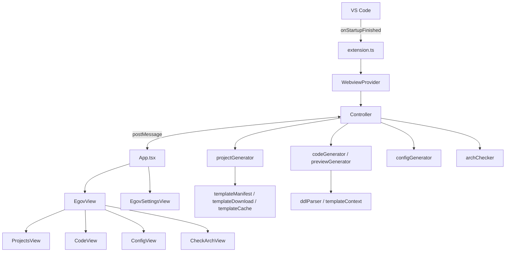

# 아키텍처

이 문서는 eGovFrame VSCode Initializr 확장의 구성, 확장 호스트와 웹뷰 사이의 메시지 계약, 기능별 처리 흐름, 폴더 구조를 설명합니다. 아키텍처 점검 엔진의 내부는 [ARCH_CHECK_ENGINE.md](./ARCH_CHECK_ENGINE.md)에서, 개발 환경과 코드 수정 규칙은 [DEVELOPMENT_GUIDE.md](../development/DEVELOPMENT_GUIDE.md)에서 다룹니다.

## 전체 구조

저장소는 **두 개의 npm 패키지**로 이루어져 있습니다. 루트 패키지는 Node.js에서 실행되는 확장 호스트(Extension Host)이고, `webview-ui/` 패키지는 사이드바에 표시되는 React 웹뷰입니다. 두 패키지는 `postMessage()`로만 통신합니다.

```text
┌──────────────────────────────────────────────────────────────────────────┐
│                               VS Code                                    │
├────────────────────────────────────┬─────────────────────────────────────┤
│  Extension Host (Node.js)          │  Webview (브라우저 환경)            │
│  src/                              │  webview-ui/src/                    │
│                                    │                                     │
│  extension.ts                      │  App.tsx                            │
│    └─ WebviewProvider              │    ├─ EgovView (탭 4개)             │
│         └─ Controller              │    │    ├─ ProjectsView             │
│              ├─ projectGenerator   │    │    ├─ CodeView                 │
│              ├─ codeGenerator      │    │    ├─ ConfigView               │
│              ├─ previewGenerator   │    │    └─ CheckArchView            │
│              ├─ configGenerator    │    └─ EgovSettingsView              │
│              └─ archChecker        │                                     │
│                                    │                                     │
│  파일 시스템, 네트워크 접근 가능   │  파일 시스템 접근 불가              │
│  웹뷰 메시지를 zod 스키마로 검증   │  postMessage()로만 확장과 통신      │
├────────────────────────────────────┴─────────────────────────────────────┤
│  templates/  프로젝트 ZIP과 POM, CRUD 코드 템플릿, 설정 템플릿           │
└──────────────────────────────────────────────────────────────────────────┘
```

| 구분 | 확장 호스트 | 웹뷰 |
|------|-------------|------|
| 위치 | 루트 패키지 (`src/`) | `webview-ui/` 패키지 |
| 실행 환경 | Node.js (VS Code에 내장) | 웹뷰의 브라우저 환경 |
| 빌드 | esbuild로 `dist/extension.js` 하나로 번들 (CommonJS) | Vite로 `webview-ui/build/assets/index.js`, `index.css`로 번들 |
| 역할 | 파일 읽기와 쓰기, 템플릿 렌더링, 다운로드, 점검 엔진 실행 | 입력 폼, 미리보기, 결과 표시 |
| 다국어 | 적용하지 않음 | i18next (영어, 한국어) |

## 진입점과 구성 요소



| 구성 요소 | 파일 | 책임 |
|-----------|------|------|
| 확장 진입점 | `src/extension.ts` | 출력 채널("eGovFrame Initializr") 생성, 사이드바 웹뷰 등록, 명령 3개(`egovframe.egovButtonClicked`, `egovframe.clearTemplateCache`, `egovframe.showTemplateCacheInfo`) 등록 |
| WebviewProvider | `src/core/webview/index.ts` | 웹뷰의 HTML과 CSP 생성, 웹뷰 인스턴스 관리, 수신한 메시지를 Controller에 전달. 사이드바 뷰(`egovframe.SidebarProvider`)와 편집기 탭 패널(`egovframe.TabPanelProvider`)을 한 클래스가 담당합니다. |
| Controller | `src/core/controller/index.ts` | 웹뷰 메시지의 검증과 분기(`handleWebviewMessage`), 생성기와 점검 엔진 호출, 결과 회신, VS Code 테마 변경 전달 |
| 캐시 명령 | `src/commands/clearTemplateCache.ts` | 템플릿 캐시의 조회와 삭제 명령 |
| 웹뷰 앱 | `webview-ui/src/App.tsx` | 탭 화면(`EgovView`)과 설정 화면(`EgovSettingsView`)의 전환 |

확장은 VS Code가 시작된 뒤(`onStartupFinished`)에 활성화됩니다. 편집기 탭 패널을 여는 명령은 코드에 주석으로 남아 있으며 5.1.0에서는 사이드바 뷰만 제공합니다.

## 메시지 계약

확장 호스트와 웹뷰는 `type` 필드로 구분되는 메시지를 주고받습니다.

| 파일 | 방향 | 내용 |
|------|------|------|
| `src/shared/WebviewMessage.ts` | 웹뷰 → 확장 | 판별 유니온 타입. 두 패키지가 함께 import하므로 타입만 둡니다. |
| `src/shared/webviewMessageSchema.ts` | 웹뷰 → 확장 | 위 타입과 같은 모양의 zod 스키마와 `parseWebviewMessage()`. 확장 호스트에서만 사용하며 웹뷰는 import하지 않습니다. |
| `src/shared/ExtensionMessage.ts` | 확장 → 웹뷰 | 확장이 보내는 메시지의 타입 |
| `src/shared/webviewMessageRouting.ts` | 확장 → 웹뷰 | 탭 스코프(`scope`)로 메시지의 수신 탭을 가리는 순수 함수 |

### 수신 메시지의 검증

웹뷰가 보낸 값은 신뢰 경계 밖의 입력으로 봅니다. `Controller.handleWebviewMessage()`는 `parseWebviewMessage()`를 통과한 메시지만 처리하고, 실패한 메시지는 사유를 출력 채널에 남기고 버립니다.

- 경로를 만드는 데 쓰이는 필드(프로젝트 이름, 패키지 이름 등)는 스키마에서 안전한 문자 집합으로 제한합니다.
- zod는 스키마에 없는 필드를 **제거(strip)** 합니다. 그래서 타입에 필드를 추가하고 스키마에 추가하지 않으면, 그 값은 오류 없이 사라집니다.
- 스키마 파일 하단의 컴파일 타임 검증이 타입과 스키마의 불일치를 잡아내므로, 둘이 어긋나면 `npm run check-types`가 실패합니다.

### 탭 스코프

확장이 보내는 응답 가운데 특정 탭의 요청에 대한 것은 `scope`(`projects`, `code`, `config`, `settings`, `archCheck`)를 달고 나갑니다. 각 탭은 자기 스코프의 메시지와 스코프가 없는 메시지(전체 탭에 알리는 브로드캐스트)만 처리합니다. 이 구조 덕분에 한 탭의 실패가 다른 탭의 오류 화면으로 번지지 않습니다.

### 메시지 목록 (웹뷰 → 확장)

| 메시지 | 발신 탭 | 처리 |
|--------|---------|------|
| `webviewDidLaunch`, `getCurrentTheme` | 공통 | 초기화, 현재 테마 회신 |
| `getEgovSettings`, `updateEgovSettings`, `getExtensionInfo` | 설정 화면, 각 탭 | `egovframeInitializr.*` 설정의 조회와 저장, 확장 정보 회신 |
| `getDefaultSettings` | 프로젝트 | 그룹 ID 등 기본 설정 회신 (`egovSettings`) |
| `getWorkspacePath` | 프로젝트, 코드, 아키텍쳐 | 워크스페이스 경로 회신 |
| `selectOutputPath` | 프로젝트, 코드 | 폴더 선택 대화상자 |
| `getProjectTemplates`, `generateProject` | 프로젝트 | 매니페스트 회신, 프로젝트 생성 |
| `getSampleDDLs`, `validateDDLOnly`, `validateAndPreview` | 코드 | 샘플 DDL 회신, DDL 검증, 검증과 미리보기 생성 |
| `generateCode`, `uploadTemplates`, `downloadTemplateContext` | 코드 | CRUD 코드 생성, 커스텀 템플릿 렌더링, 템플릿 컨텍스트 저장 |
| `getConfigTemplates`, `generateConfig` | 설정 | 설정 유형 회신, 설정 파일 생성 |
| `selectOutputFolder` | 설정의 각 폼 | 출력 폴더 선택과 같은 이름의 파일 검사 |
| `selectConfigFilePath` | 설정의 Ehcache 폼 | 참조할 설정 파일의 경로 선택 |
| `selectProjectPath`, `startArchCheck`, `exportArchResults`, `openFile` | 아키텍쳐 | 점검 대상 선택, 점검 실행, CSV 내보내기, 파일 열기 |

다음 메시지는 타입과 스키마에 남아 있지만 5.1.0의 웹뷰가 실제로 쓰지 않습니다.

- `openPackageSettings`, `showError`, `showWarning`: Controller에 처리가 있지만 웹뷰가 보내지 않습니다.
- `generateProjectByCommand`: 명령어 기반 프로젝트 생성용 메시지입니다. 화면의 생성 방식 선택이 숨겨져 있고 Controller의 처리도 주석으로 남아 있어 동작하지 않습니다.

## 기능별 처리 흐름

### 프로젝트 생성

```text
ProjectsView ── generateProject { projectConfig: { template: { templateId, version }, ... } } ──▶ Controller
  1. templateManifest.loadProjectTemplatesManifest()   번들된 templates-projects.json 로드
  2. templateManifest.resolveProjectTemplate()          (templateId, version) → ResolvedProjectTemplate
  3. projectGenerator.generateEgovProject()
       a. 프로젝트 이름 검증, 출력 경로 밖으로 벗어나지 않는지 확인 (pathSafety)
       b. 같은 이름의 폴더가 있으면 중단
       c. 템플릿 ZIP 확보: 내장 버전은 확장 디렉터리에서, 다운로드 버전은 templateDownload.ensureVerifiedFile()
       d. adm-zip으로 압축 해제
       e. POM 템플릿이 있으면 자리 표시자를 치환해 pom.xml 작성
Controller ── projectGenerationProgress / projectGenerationResult ──▶ ProjectsView
```

- 웹뷰는 템플릿의 식별자와 버전만 보냅니다. 파일 이름, 다운로드 경로, 해시는 확장에 번들된 매니페스트에서 확정하므로, 웹뷰가 임의의 URL이나 캐시 경로를 지정할 수 없습니다.
- 다운로드는 `templateDownload.ts`가 담당합니다. https만 허용하고, 리다이렉트 5회, 크기 200MB, 소켓 타임아웃 60초의 상한을 두며, `.part` 임시 파일에 받으면서 sha256을 계산합니다. 해시가 기록되지 않은 항목은 `requireSha256()`이 거부합니다.
- 캐시 경로는 `templateCache.ts`가 정합니다: `<globalStorageUri>/template-cache/{examples,pom}/<version>/<fileName>`. 확장 디렉터리 아래의 파일은 모두 VSIX에 포함되므로, 내려받은 파일을 확장 디렉터리에 쓰지 않습니다.
- 압축 해제는 `adm-zip`으로 동기 처리합니다. 스트림 방식의 추출기(extract-zip, yauzl)는 VS Code 1.128 이후의 Node.js에서 큰 템플릿을 풀 때 끝나지 않는 문제가 있어 사용하지 않습니다.
- 해시가 일치하지 않으면 `TemplateIntegrityError`가 발생하고, 결과 메시지에 `errorCode: "templateIntegrity"`가 실립니다. 웹뷰는 이 값을 보고 무결성 안내 문구를 표시합니다.

### CRUD 코드 생성

```text
CodeView ── validateDDLOnly { ddl, packageName } ──▶ previewGenerator.validateDDLOnly()          빠른 검증 (디바운스 500ms)
CodeView ── validateAndPreview { ddl, packageName } ──▶ previewGenerator            검증 + 11개 템플릿 병렬 렌더링
CodeView ── generateCode { ddl, packageName, outputPath } ──▶ codeGenerator.generateCrudFromDDL()
  1. ddlParser.parseDDL()                      테이블 이름, 컬럼, 기본 키 추출
  2. templateContext.getTemplateContext()      렌더링 컨텍스트 생성
  3. codeTemplateFiles.getTemplateFilesConfig() 템플릿별 출력 경로와 파일 이름
  4. Handlebars 렌더링 (templates/code/*.hbs)
  5. 파일 선택 목록(QuickPick) 표시 후 선택한 파일 저장
```

- `src/shared/ddlParser.ts`는 외부 파서 없이 정규식으로 DDL을 해석합니다. 컬럼의 Java 타입과 화면 입력란 종류는 `src/shared/dataTypes.ts`가 정합니다.
- `src/shared/erdParser.ts`의 `parseErdModel()`이 같은 DDL을 테이블과 외래키 관계로 해석하고, 웹뷰의 `ErdDiagram.tsx`가 다이어그램으로 그립니다. 이 해석은 웹뷰 안에서 수행됩니다.
- 검증과 미리보기를 나눈 이유는, 입력할 때마다 11개 템플릿을 렌더링하지 않고 사용자가 요청했을 때에만 전체 미리보기를 만들기 위해서입니다.
- 템플릿별 출력 경로는 `codeTemplateFiles.ts`에 있으며 `vscode`에 의존하지 않아 단위 테스트로 검증합니다.

### 설정 파일 생성

```text
ConfigView ── getConfigTemplates ──▶ templates-context-xml.json 회신
폼 ── selectOutputFolder { formData } ──▶ 폴더 선택, configGenerator.checkFileExistence()로 중복 검사
ConfigView ── generateConfig { template, formData } ──▶ configGenerator.generateConfigFile()
  1. 출력 형식에 맞는 템플릿 선택 (templateFile / javaConfigTemplate / yamlTemplate / propertiesTemplate)
  2. Handlebars 렌더링 (templates/config/<category>/*.hbs)
  3. 파일 이름 정리(sanitizeFileName), 출력 폴더 안인지 확인(resolveWithinBase) 후 저장
```

웹뷰의 폼 컴포넌트는 9개이며(`webview-ui/src/components/egov/forms/`), Logging, Scheduling, ID Generation, Transaction 폼은 하나의 컴포넌트가 여러 설정 유형을 처리합니다. `FormFactory.tsx`는 메타데이터의 `webView` 값(예: `logging-console-form.html`)에 들어 있는 문자열로 폼과 폼의 유형을 고릅니다. 출력 폴더의 선택은 각 폼이 요청하고, 생성 요청은 폼의 제출을 받은 `ConfigView`가 보냅니다.

### 아키텍처 점검

```text
CheckArchView ── startArchCheck { projectPath, runtimeGeneration? } ──▶ Controller
  1. ripgrepPath.resolveRipgrepPath()        VS Code에 내장된 rg 탐색
  2. archChecker.checkEgovArchitecture()     Project → DAO / Mapper → 데이터 접근 설정 → Controller → Service
Controller ── archCheckProgress / archCheckResult ──▶ CheckArchView
CheckArchView ── exportArchResults { results, projectPath } ──▶ archChecker.exportArchResults()   CSV 작성
```

점검 결과는 웹뷰가 보관하다가 CSV로 내보낼 때 확장으로 다시 보냅니다. 이때 결과가 zod 스키마를 거치므로, 결과 타입에 추가한 필드는 스키마에도 추가해야 CSV에 실립니다. 엔진의 모듈 구성은 [ARCH_CHECK_ENGINE.md](./ARCH_CHECK_ENGINE.md)에 있습니다.

## 폴더 구조

### 루트

```text
egovframe-vscode-initializr/
├── src/                     # 확장 호스트 소스
├── webview-ui/              # React 웹뷰 (별도 npm 패키지)
├── templates/               # 프로젝트, CRUD 코드, 설정 템플릿과 메타데이터
├── assets/icons/            # Activity Bar 아이콘 등
├── docs/                    # 문서
├── .vscode/                 # 디버그 실행 설정(launch.json), 빌드 태스크(tasks.json)
├── .husky/                  # pre-commit(lint-staged), pre-push(Git LFS) 훅
├── package.json             # 확장 매니페스트와 npm 스크립트
├── esbuild.js               # 확장 호스트 빌드 설정 (경로 별칭 포함)
├── tsconfig.json            # TypeScript 설정 (경로 별칭 포함)
├── vitest.config.ts         # 확장 호스트 테스트 설정
├── .vscodeignore            # VSIX에서 제외할 파일
├── .gitattributes           # Git LFS 대상 (*.zip)
├── .nvmrc                   # Node.js 22
├── CHANGELOG.md
├── CONTRIBUTING.md
└── README.md
```

### 확장 호스트 (`src/`)

```text
src/
├── extension.ts                    # 진입점 (activate / deactivate)
├── commands/
│   └── clearTemplateCache.ts       # 템플릿 캐시 조회·삭제 명령
├── core/
│   ├── controller/index.ts         # 웹뷰 메시지 검증과 분기, 생성기 호출
│   └── webview/index.ts            # WebviewProvider (HTML, CSP, 인스턴스 관리)
├── shared/                         # 확장과 웹뷰가 함께 쓰는 모듈 (vscode에 의존하지 않음)
│   ├── WebviewMessage.ts           #   웹뷰 → 확장 메시지 타입
│   ├── webviewMessageSchema.ts     #   위 타입의 zod 스키마 (확장 호스트 전용)
│   ├── webviewMessageRouting.ts    #   탭 스코프 라우팅 함수
│   ├── ExtensionMessage.ts         #   확장 → 웹뷰 메시지 타입
│   ├── ddlParser.ts                #   DDL 파서
│   ├── dataTypes.ts                #   SQL 타입 → Java 타입, 입력란 종류
│   ├── erdParser.ts                #   ERD 미리보기용 테이블·관계 파서
│   ├── templateContext.ts          #   CRUD 템플릿 컨텍스트
│   ├── placeholderUtil.ts          #   POM 템플릿의 자리 표시자 치환
│   ├── archCheck.ts                #   아키텍처 점검 결과 타입
│   ├── archCheckReport.ts          #   Project 결과를 보고 행으로 펴는 함수
│   └── AutoApprovalSettings.ts     #   웹뷰 상태 타입이 참조하는 설정 타입
└── utils/
    ├── projectGenerator.ts         # 프로젝트 생성
    ├── templateManifest.ts         # 프로젝트 템플릿 매니페스트 로드와 해석
    ├── templateDownload.ts         # 검증된 다운로드 (https, 상한, sha256)
    ├── templateCache.ts            # 다운로드 캐시의 경로와 조회·삭제
    ├── codeGenerator.ts            # CRUD 코드 생성, 커스텀 템플릿, 템플릿 컨텍스트 저장
    ├── codeTemplateFiles.ts        # CRUD 템플릿별 출력 경로와 파일 이름
    ├── codeGeneratorUtils.ts       # Handlebars 렌더링 공통 함수
    ├── previewGenerator.ts         # DDL 검증과 미리보기 생성
    ├── configGenerator.ts          # 설정 파일 생성
    ├── archChecker.ts              # 아키텍처 점검 엔진 진입점, CSV 작성
    ├── daoCheck.ts                 # DAO / Mapper 레이어 판정
    ├── buildFileCheck.ts           # Project 항목 (빌드 파일) 판정
    ├── dataAccessConfigScan.ts     # 데이터 접근 설정 정보
    ├── runtimeModuleGraph.ts       # 실행환경 모듈 의존 그래프
    ├── mavenPom.ts                 # pom.xml 파서
    ├── gradleBuild.ts              # Gradle 빌드 파일 파서
    ├── javaIndex.ts                # .java 파일의 FQCN 색인
    ├── javaSource.ts               # Java 소스의 주석 제거와 선언부 추출
    ├── ripgrepPath.ts              # VS Code 내장 ripgrep 탐색
    ├── pathSafety.ts               # 프로젝트 이름·파일 이름 검증, 경로 이탈 방지
    ├── SampleDDLs.ts               # 샘플 DDL
    ├── fs.ts, path.ts, shell.ts    # 보조 함수
    └── __tests__/                  # 확장 호스트 테스트와 fixture
```

### 템플릿 (`templates/`)

```text
templates/
├── templates-projects.json         # 프로젝트 템플릿 매니페스트 (템플릿 23종, 버전, 다운로드 경로, sha256)
├── templates-context-xml.json      # 설정 유형 21종의 메타데이터
├── projects/
│   ├── examples/                   # 프로젝트 템플릿 ZIP 23개 (Git LFS)
│   └── pom/                        # POM 템플릿 19개
├── code/                           # CRUD 코드 템플릿 11개 (.hbs)
└── config/                         # 설정 템플릿 52개 (.hbs)
    ├── cache/                      #   4개
    ├── datasource/                 #   4개
    ├── idGeneration/               #   6개
    ├── logging/                    #   20개
    ├── property/                   #   2개
    ├── scheduling/                 #   10개
    └── transaction/                #   6개
```

- `templates/projects/examples/`의 ZIP은 모두 Git LFS로 관리합니다. 파일 크기가 130바이트 안팎이면 실제 파일이 아니라 LFS 포인터입니다.
- CRUD 코드 템플릿의 메타데이터(출력 경로, 파일 이름)는 JSON이 아니라 `src/utils/codeTemplateFiles.ts`의 `getTemplateFilesConfig()`에 있습니다.
- `.vscodeignore`가 `templates/` 아래를 제외하지 않으므로, 이 디렉터리의 파일은 모두 VSIX에 포함됩니다.

### 웹뷰 (`webview-ui/`)

```text
webview-ui/
├── package.json                    # 웹뷰 의존성과 스크립트
├── vite.config.ts                  # 빌드와 테스트 설정 (개발 서버 포트 25463)
├── build/                          # 빌드 결과 (assets/index.js, assets/index.css)
└── src/
    ├── main.tsx, App.tsx           # 진입점, 탭 화면과 설정 화면 전환
    ├── components/
    │   ├── egov/
    │   │   ├── EgovView.tsx                # 탭 내비게이션
    │   │   ├── EgovSettingsView.tsx        # 설정 화면
    │   │   ├── CodePreview.tsx             # Monaco 기반 코드 미리보기
    │   │   ├── ErdDiagram.tsx              # ERD 미리보기
    │   │   ├── tabs/
    │   │   │   ├── ProjectsView.tsx        # 프로젝트 탭
    │   │   │   ├── CodeView.tsx            # 코드 생성기 탭
    │   │   │   ├── ConfigView.tsx          # 설정 탭
    │   │   │   ├── CheckArchView.tsx       # 아키텍쳐 탭
    │   │   │   └── checkArch/              # Project 카드와 상세 표, 표시 규칙
    │   │   ├── forms/                      # 설정 유형별 폼 9개와 FormFactory.tsx
    │   │   └── types/templates.ts          # 설정 폼 데이터 타입
    │   └── ui/                             # VS Code 스타일의 공통 컴포넌트
    ├── context/                    # ExtensionStateContext, EgovTabsStateContext
    ├── i18n/                       # i18next 설정과 locales/en.json, ko.json
    ├── shared/egovframe.ts         # 탭 식별자
    └── utils/                      # 검증, 메시지 생성, 훅 등 보조 함수
```

웹뷰는 별칭 `@shared`로 루트의 `src/shared/`를 import합니다. 그래서 DDL 파서, ERD 파서, 메시지 타입을 두 패키지가 같은 소스로 사용합니다.

## 웹뷰 UI

### VS Code 테마 통합

UI 컴포넌트 라이브러리를 쓰지 않고, VS Code의 CSS 변수(`--vscode-*`)를 읽는 자체 컴포넌트(`webview-ui/src/components/ui/`)를 사용합니다. 그래서 VS Code의 테마를 바꾸면 웹뷰도 함께 바뀝니다. 컴포넌트는 변수를 직접 쓰지 않고 `components/ui/theme.ts`가 정의한 테마 값을 통해 읽습니다.

| 테마 값 (`theme.ts`) | VS Code 변수 | 쓰는 컴포넌트 |
|----------------------|--------------|----------------|
| `buttonBackground`, `buttonForeground`, `buttonHoverBackground` | `--vscode-button-*` | Button, 그리고 Checkbox, RadioGroup, ProgressRing, Link의 강조색 |
| `buttonSecondaryBackground`, `buttonSecondaryForeground` | `--vscode-button-secondary*` | Button (secondary) |
| `inputBackground`, `inputForeground` | `--vscode-input-*` | TextField, TextArea, Select, Checkbox, RadioGroup |
| `inputBorder` | `--vscode-settings-textInputBorder` | 입력 컴포넌트의 테두리 |
| `focusBorder` | `--vscode-focusBorder` | 포커스 테두리 |
| `descriptionForeground` | `--vscode-descriptionForeground` | 보조 문구, Link |
| `panelBorder` | `--vscode-panel-border` | Divider |

Monaco 편집기의 테마는 CSS 변수로 바뀌지 않으므로, Controller가 VS Code의 테마 변경(`onDidChangeActiveColorTheme`)을 받아 `light` 또는 `vs-dark`로 바꾸어 웹뷰에 전달합니다.

### Monaco 편집기

DDL 입력과 코드 미리보기에 Monaco 편집기를 사용합니다.

- `monaco-sql-languages`가 MySQL과 PostgreSQL의 문법 강조와 실시간 문법 검사를 제공합니다. Generic 방언은 기본 SQL 모드로 동작합니다.
- 방언별 언어 Worker는 Vite의 `?worker&inline`으로 번들에 인라인됩니다. 웹뷰에서는 외부 Worker 파일을 불러올 수 없기 때문입니다.
- `@monaco-editor/react`가 Monaco를 CDN에서 불러오지 않도록 `loader.config({ monaco })`로 번들된 Monaco를 지정합니다.
- 검증은 내용 변경 후 500ms 디바운스로 실행하고, Worker가 마커를 갱신할 때(`onDidChangeMarkers`) 결과를 반영합니다.

### 다국어

웹뷰의 문구는 `webview-ui/src/i18n/locales/en.json`과 `ko.json`에 있습니다. 초기 언어는 확장 호스트가 `egovframeInitializr.language` 설정을 읽어 웹뷰 HTML에 심어 주고(`window.__EGOV_INIT_LANGUAGE__`), 설정 화면에서 저장하면 즉시 바뀝니다. 아키텍쳐 탭(`CheckArchView`)은 아직 다국어 처리가 되어 있지 않습니다.

### 보안 설정 (CSP)

웹뷰는 스크립트 실행이 켜져 있고(`enableScripts: true`) `postMessage`로 확장 호스트에 닿으므로, 웹뷰 HTML(`getHtmlForWebview()`)에 Content-Security-Policy를 설정합니다.

| 지시문 | 값 | 이유 |
|--------|-----|------|
| `default-src` | `'none'` | 기본은 전부 차단 |
| `script-src` | `'nonce-<난수>'`, 웹뷰 리소스 | nonce가 붙은 인라인 스크립트와 번들 스크립트만 허용 |
| `style-src` | 웹뷰 리소스, `'unsafe-inline'` | 인라인 스타일과 Monaco가 주입하는 `<style>` 허용 |
| `worker-src` | 웹뷰 리소스, `blob:` | 인라인된 Monaco Worker가 `blob:` URL에서 생성됨 |
| `font-src`, `img-src` | 웹뷰 리소스, `data:` | codicon 폰트와 인라인 아이콘 |

- `worker-src`에 `blob:`이 없으면 `default-src 'none'`이 적용되어 Worker 생성이 차단되고, SQL 문법 강조와 실시간 검증이 동작하지 않습니다.
- nonce는 웹뷰 HTML을 만들 때마다 새로 생성합니다.
- VS Code의 Electron 버전에 따라 Worker 스크립트를 `script-src`로도 검사해서 Worker가 차단되는 경우에는, `worker-src`에 `data:`를 추가하거나 `script-src`에 `blob:`을 추가합니다.

## 경로 별칭

| 패키지 | 별칭 | 대상 | 정의 위치 |
|--------|------|------|-----------|
| 확장 호스트 | `@/*`, `@core/*`, `@shared/*`, `@utils/*` | `src/*`, `src/core/*`, `src/shared/*`, `src/utils/*` | `tsconfig.json`, `esbuild.js`의 `aliasResolverPlugin` |
| 웹뷰 | `@/*`, `@components/*`, `@context/*`, `@utils/*` | `webview-ui/src/` 아래 | `webview-ui/tsconfig.app.json`, `webview-ui/vite.config.ts` |
| 웹뷰 | `@shared/*` | 루트의 `src/shared/*` | 위와 같음 |

두 tsconfig에는 `baseUrl`이 없으므로(TypeScript 7.0 대비) `paths`의 값은 `./src/*`처럼 상대 경로로 적어야 합니다. 별칭을 추가할 때에는 tsconfig와 번들러 설정을 함께 고칩니다.
